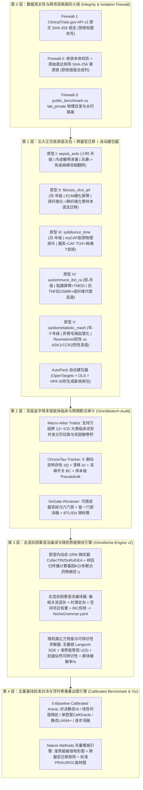

# OmniNiche v2.0 跨疾病通用多智能体与多细胞微环境动力学平台架构设计规范（顶刊满配版）

> [!IMPORTANT]
> **项目双定位与零冲突隔离原则**
> 1. **全新独立代码库与数据仓（整库落盘 F 盘）**：所有代码、Git 历史与未来下载数据集全部统一存放在 [F:/OmniNiche_Universal/](file:///F:/OmniNiche_Universal/)，绝不修改或触碰已锁定归档的 *Nature Biomedical Engineering* 在审稿件包（`nBME-26-6122`，[D:/AI工具/NeuroImmune_Virtual_Biotech/flagship_paper/submission_package_v1.0/](file:///D:/AI工具/NeuroImmune_Virtual_Biotech/flagship_paper/submission_package_v1.0/)）。
> 2. **对标 2025–2026 CNS / *Nature Methods* / *Nature Biotechnology* 满配标准**：
>    - **体量升级（双层金字塔）**：塔基支持横扫 $10,000\text{--}25,000+$ 项跨 12+ ICD 非神经疾病大类临床试验 + 塔中 $20\text{--}25$ 个纵向/多期单细胞与空间转录组队列 + 塔尖真实临床治疗应答（Responder/Non-Responder）与 CRISPR/药物微扰真值盲测；
>    - **算法升级（四大核心）**：① 去混杂因果跨细胞边提取（对标 *Nat. Methods* 2026 `CauTrigger`）；② 无量纲化随机朗之万微分方程（Langevin SDE）与 Waddington 多细胞准势能景观 $U(\mathbf{S})$（对标 *Nat. Biotechnol.* 2026 `DynaVelo`）；③ 剖面似然（Profile Likelihood）结构可辨识性与 BIC 稀疏拓扑剪枝；④ 五重校准基线正面对决评测框架（对标 *Nat. Biotechnol.* 2026 `PMID: 42823510`）；
>    - **疾病谱升级（五大正交原型 + 跨器官迁移）**：覆盖**脓毒症/ARDS**、**肾-肺跨器官纤维化（含肾 $\to$ 肺零样本语法迁移实验）**、**实体瘤基质免疫排斥**、**自身免疫病生物制剂代偿耐药**、**心血管代谢性脂肪性肝炎（MASH 正负临床真值金矿）**五大非中枢神经主流疾病谱，外加任意新疾病 30 秒自动建包器与课题组私有轴隔离模式。

---

## 一、 系统总体五层解耦架构（v2.0）



---

## 二、 四大核心算法数学规范（v2.0 升级）

### 1. 腔室内单细胞 GRN 微扰传播（Intra-Compartment GRN Perturbation Prior）
对微环境中的每个细胞腔室 $c \in \{1, \dots, N\}$，基于单细胞表达矩阵 $\mathbf{X}^{(c)}$ 与先验转录因子互作掩码 $\mathbf{M}_{\text{prior}}$（`CollecTRI` / `DoRothEA`），通过带 $L_2$ 正则化（$\lambda > 0$）的岭回归求解线性化局部调控算子：
$$\mathbf{W}^{(c)} = \arg\min_{\mathbf{W} \odot (1 - \mathbf{M}_{\text{prior}}) = 0} \left\| \mathbf{X}^{(c)} - \mathbf{X}^{(c)}\mathbf{W} \right\|_F^2 + \lambda \|\mathbf{W}\|_F^2$$
对候选靶点集合 $\mathcal{T}$ 施加基因敲除或按药物亲和力 $p\text{IC}_{50}$ 加权的微扰向量 $\Delta \mathbf{x}^{(0)}$，经 $L=3$ 步迭代传播 $\Delta \mathbf{x}^{(L)} = \sum_{\ell=1}^{L} (\mathbf{W}^{(c)})^\ell \Delta \mathbf{x}^{(0)}$，投影到腔室致病态签名单位向量 $\hat{\mathbf{p}}^{(c)}$ 上，得到有界微扰效能系数：
$$\eta(\mathcal{T}, c) = \tanh\!\left(\frac{\langle \Delta \mathbf{x}^{(L)}, -\hat{\mathbf{p}}^{(c)} \rangle}{\sigma_c}\right) \in [-1, 1]$$

### 2. 去混杂因果跨细胞语法自动编译与 BIC 稀疏剪枝（Deconfounded Causal AutoGrammar）
为防止全身系统性炎症背景 $Z(t)$ 造成虚假跨细胞边：
1. 计算腔室 $i$ 的配体输出活性 $L_i(t_k)$ 与腔室 $j$ 的同源受体-下游 TF 激活度 $R_j(t_k)$ 在控制全局微环境负载 $Z(t_k) = \frac{1}{N}\sum_m S_m(t_k)$ 后的**偏相关增益（Partial Correlation Gain）** $r_{i \to j \mid Z}$ 及跨期时滞定向分数（$t_{k-1} \to t_k$）；
2. 若提供空间转录组邻域富集矩阵 $\mathbf{\Omega}_{\text{spatial}}$，施加物理邻近权重 $w_{ij}^{\text{eff}} = r_{i \to j \mid Z} \cdot \sigma(\Omega_{ij})$；
3. 采用 **贝叶斯信息准则（BIC）稀疏剪枝** 仅保留使 $\text{BIC} = k \ln(M) + M \ln(\text{RSS}/M)$ 最小化的核心有向边与强连通正反馈环，自动导出人类可读的 `NicheGrammar.yaml`（支持跨器官零样本替换基因同源映射后直接迁移预测，如 `Kidney Fibrosis Grammar` $\to$ `Lung IPF`）。

### 3. 无量纲随机朗之万动力学、准势能景观 $U(\mathbf{S})$ 与剖面似然可辨识性
将所有腔室致病态变量无量纲化至 $S_j(t) \in [0, 1]$，构建带异质性扩散噪声 $\sigma_j$ 的随机朗之万方程（Euler-Maruyama 向量化模拟 $M_{\text{ens}} = 200\text{--}1,000$ 个虚拟患者轨迹）：
$$dS_j = \left[ \alpha_j + (1 - S_j) \sum_{i \in \mathcal{A}(j)} v_{ij} \frac{S_i^{n_{ij}}}{K_{ij}^{n_{ij}} + S_i^{n_{ij}}} \prod_{r \in \mathcal{I}(j)} \frac{K_{rj}^{n_{rj}}}{K_{rj}^{n_{rj}} + S_r^{n_{rj}}} \left(1 - u_j(t)\,\eta_j\,\mathcal{B}(m, t)\right) - \gamma_j S_j \right] dt + \sigma_j \sqrt{S_j(1 - S_j)}\,dW_j$$
- **Waddington 准势能景观**：由稳态核密度估计直接求得 $U(\mathbf{S}) = -\ln(P_{\text{ss}}(\mathbf{S}) + \varepsilon)$，定量计算致病自锁吸引子与健康吸引子之间的**鞍点破锁能垒 $\Delta U_{\text{barrier}}$**；
- **群体模拟临床缓解率（Simulated ORR / Remission %）**：统计治疗终点回到健康吸引盆（$S_{\text{effector}} < S_{\text{remission}}$）的虚拟患者比例，直接与真实临床试验缓解率对账；
- **剖面似然可辨识性门禁（Profile Likelihood Identifiability）**：对每个自由参数 $\theta_q$ 扫描似然剖面 $\chi^2_{\text{PL}}(\theta_q) - \chi^2_{\min}$，自动标记并冻结平坦不可辨识参数（要求保留参数满足 $95\%$ $\chi^2_{1}$ 置信区间双侧闭合）。

### 4. 五重校准基线正面对决框架（5-Baseline Calibrated Arena）
在 `omniniche/benchmark/calibrated_arena.py` 中统一封装并输出校准指标（Calibrated AUROC、AUPRC、Brier Score、Energy Distance / Pearson $\Delta_{\text{cal}}$）：
1. **`B1_Static_Healthy_Tau`**：仅用稳态/正常组织静态 $\tau_0$（*Science* 2026 Virtual Biotech 静态基线）；
2. **`B2_Uninformative_Linear_Mean`**：无信息扰动均值与多药线性加和基线（*Nat. Biotechnol.* 2026 `PMID: 42823510` 强制校准基线）；
3. **`B3_SingleCell_GRN_Only`**：仅有腔室内 `CellOracle`-style GRN 微扰 $\eta$，无跨细胞反馈与屏障窗口；
4. **`B4_Static_LR_Centrality`**：仅有静态配受体网络中心度（`LIANA+/CellChat` 风格），无时间积分自锁动力学；
5. **`OmniNiche_v2_Full`（及逐模块消融）**。

---

## 三、 工程阶段 I 目录结构与 TDD 实施模块

```text
F:/OmniNiche_Universal/
├── pyproject.toml
├── data_vault/                          # F 盘高速数据仓 (大文件 .gitignore 排除，仅保留 SHA-256 清单)
│   ├── raw_clinical_trials/             # ClinicalTrials.gov API v2 原始 JSON 与 PRISMA 台账
│   ├── raw_single_cell/                 # GEO / CELLxGENE 原始 .h5ad / 10x 稀疏矩阵 (流式分块读取 <10GB RAM)
│   ├── processed_pseudobulk/            # 样本级 Pseudobulk 与腔室致病轨迹缓存
│   └── perturbation_benchmarks/         # 公开单细胞基因/药物微扰校准真值集
├── omniniche/
│   ├── __init__.py
│   ├── core/
│   │   ├── schema.py                    # DiseasePack (含跨器官迁移映射), NicheGrammar, TrialRecord 强类型模型
│   │   └── integrity_firewall.py        # Firewall 1-3: NCT 原文逐字锁 / 矩阵 SHA256 溯源锁 / 公私物理隔离锁
│   ├── disease_packs/
│   │   ├── loader.py                    # 疾病包加载器与跨器官语法零样本迁移适配器 (transfer_grammar)
│   │   ├── sepsis_ards.yaml             # 原型 I: 脓毒症与 ARDS
│   │   ├── fibrosis_ckm_ipf.yaml        # 原型 II: 肾纤维化 (AKI-to-CKD) -> 肺纤维化 (IPF) 跨器官迁移包
│   │   ├── solidtumor_time.yaml         # 原型 III: 实体瘤基质免疫排斥
│   │   ├── autoimmune_ibd_ra.yaml       # 原型 IV: 自身免疫黏膜/滑膜代偿逃逸
│   │   ├── cardiometabolic_mash.yaml    # 原型 V: 代谢性脂肪性肝炎 MASH (正负临床真值包)
│   │   └── autopack_agent.py            # 任意新疾病 30 秒自动建包器 (OpenTargets + OLS + HPA)
│   ├── audit/
│   │   ├── clinical_trialist_v2.py      # 支持万级试验分页拉取、PRISMA 四步纳排与行政/科学死因解卷积
│   │   ├── chronotau_tracker.py         # K 期动态 τ(t)、漂移 Δτ、开关双峰 BC 与样本级 Pseudobulk 引擎
│   │   └── sixgate_tournament.py        # 可插拔器官排污六门禁、留一门禁消融与 BTL/Elo 锦标赛
│   ├── engine/
│   │   ├── grn_perturb.py               # 腔室内岭回归 GRN 构建与单/多基因虚拟微扰传播 η
│   │   ├── autogrammar_compiler.py      # 去混杂偏相关 + 时滞定向 + 空间邻近权重 + BIC剪枝 -> NicheGrammar.yaml
│   │   └── langevin_solver.py           # 无量纲 Langevin SDE、Waddington 准势能景观 U(S)、剖面似然可辨识性、t50 与 Bliss 协同
│   ├── benchmark/
│   │   └── calibrated_arena.py          # 五重校准基线正面对决评测器与跨器官零样本迁移评测器
│   ├── viz/
│   │   └── nature_methods_plotter.py    # 顶刊级多面板矢量图引擎 (势能破锁地形图、因果语法网络、五基线校准对比图)
│   └── cli.py                           # `omniniche` 命令行主入口
├── tests/                               # 全链路 pytest 单元测试套件
└── docs/
    ├── DESIGN_SPEC_v2.0.md
    └── plans/
        └── 2026-10-30-omniniche-v2-stage1-plan.md
```
